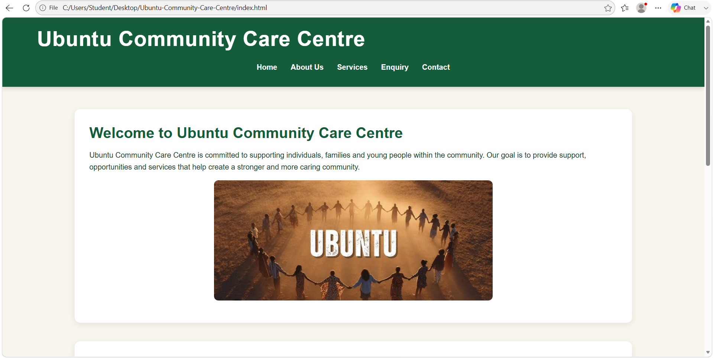
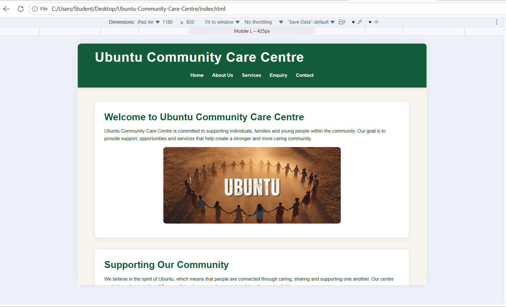
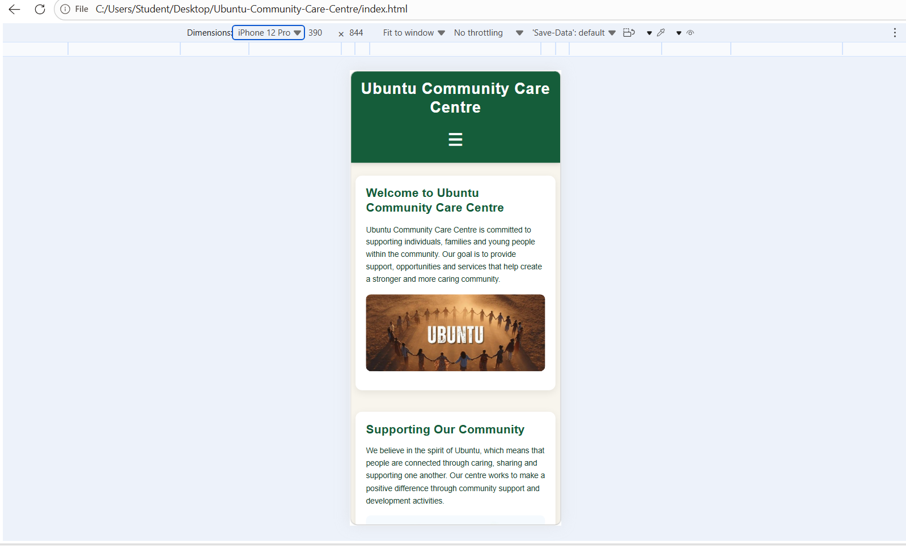

# Ubuntu Community Care Centre Website

## Student Information

**Student Name:** Liyabona Mangcengeza  
**Student Number:** S10521132
**Module:** Web Development  
**Module Code:** WEDE5020  
**Project:** Ubuntu Community Care Centre Website

---

## Project Overview

The Ubuntu Community Care Centre website is a five-page website developed for a community-based non-profit organisation in Cape Town.

The website provides information about the organisation, its services, ways for community members to get involved, and contact information.

The website is designed to be informative, easy to navigate and accessible to different users, including community members, volunteers, donors and local organisations.

---

## Goals and Objectives

The main goals of the website are to:

- Provide information about Ubuntu Community Care Centre.
- Explain the services offered by the organisation.
- Encourage community members to volunteer and contribute.
- Provide clear contact and enquiry information.
- Create a professional and user-friendly online presence.
- Make the website accessible across desktop, tablet and mobile devices.

---

## Target Audience

The website is intended for:

- Individuals and families seeking community support.
- Young people interested in development programmes.
- Volunteers.
- Donors and sponsors.
- Local businesses.
- Community members and organisations.

---

## Website Pages

The website consists of five main pages:

1. **Home (`index.html`)**  
   Introduces the organisation and provides links to important sections of the website.

2. **About Us (`about.html`)**  
   Provides information about the organisation, its history, mission, vision and values.

3. **Services (`services.html`)**  
   Describes the support and programmes offered by the organisation.

4. **Enquiry (`enquiry.html`)**  
   Allows visitors to submit enquiries about volunteering, sponsorship and general information.

5. **Contact Us (`contact.html`)**  
   Provides contact details, locations, opening hours and a contact form.

---

## Features and Functionality

The website includes:

- Five interconnected HTML pages.
- Consistent navigation across all pages.
- Semantic HTML5 elements.
- Headings and structured content.
- Images and alternative text.
- Enquiry form.
- Contact form.
- Multiple organisation locations.
- Clear calls to action.
- External CSS styling.
- Responsive design.
- Interactive hover, focus and active states.
- Responsive images.
- Services FAQ accordion.
- Service search and filtering functionality.
- Image gallery with a lightbox feature on the About Us page.
- Interactive map on the Contact Us page.
- Responsive hamburger navigation menu.
- Enquiry and contact form validation.
- JavaScript form submission with user feedback.
- Search engine optimisation (SEO) improvements.
- Structured data for the organisation and its service area.

---

## Technologies Used

The project uses:

- HTML5
- CSS3
- JavaScript
- Visual Studio Code
- GitHub

---

## Project Structure

```text
Ubuntu-Community-Care-Centre/
│
├── index.html
├── about.html
├── services.html
├── enquiry.html
├── contact.html
├── README.md
│
├── css/
│   └── style.css
│
├── js/
│   └── script.js
│
└── images/
    ├── about.jpeg
    ├── donation.jpeg
    ├── equry.jpeg
    ├── indrx.jpeg
    └── location.jpeg
    
```
    
## Responsive Design Testing   

The website was tested at different screen sizes using Chrome Developer Tools to ensure that the layout remains usable and readable across devices.

### Desktop Testing
- Tested using a desktop screen.
- Navigation displays horizontally.
- Content is arranged clearly with appropriate spacing.
- Images remain within their containers.
- Service cards display in a two-column layout where appropriate.




### Tablet Testing
- Tested using an iPad Air viewport at approximately 820px × 1180px.
- The website fits within the tablet screen without horizontal scrolling.
- Text remains readable.
- Images remain contained within their sections.
- Navigation remains accessible.
- Service cards adjust to the available screen space.



### Mobile Testing
- Tested using an iPhone 12 Pro viewport at approximately 390px × 844px.
- Navigation changes to a hamburger menu.
- Content changes to a single-column layout.
- Images resize to fit the screen.
- Text remains readable.
- No horizontal scrolling occurs.



## Part 1 Feedback Corrections

The following corrections were made based on the feedback received for Part 1:

- Added a second responsive design proposal to address the requirement for two proposals.
- Expanded the project timeline with more specific development milestones.
- Added a README file containing project information, structure, technologies and documentation.
- Corrected broken image references in the Services page.
- Expanded the references section to provide more supporting sources.
- Improved the website documentation and recorded changes in the changelog.

## Part 2 Summary

Part 2 focused on improving the visual design and responsiveness of the Ubuntu Community Care Centre website.

The following improvements were implemented:

- Added an external CSS stylesheet to all five HTML pages.
- Added consistent colours, typography, spacing and layout styling.
- Added hover, focus and active pseudo-classes.
- Added a responsive two-column service-card layout for larger screens.
- Added media queries for tablet and mobile screen sizes.
- Added a responsive hamburger navigation menu for mobile devices.
- Added responsive image handling using the HTML `<picture>` element.
- Tested the website on desktop, tablet and mobile screen sizes.
- Updated the GitHub repository using descriptive commits.

## Changelog

### Part 1

- Created the five main website pages: Home, About Us, Services, Enquiry and Contact Us.
- Added semantic HTML5 structure and organised the content using appropriate headings and sections.
- Added navigation links between all website pages.
- Added enquiry and contact forms.
- Added images with alternative text.
- Added comments to the HTML code to improve code readability.
- Created the initial GitHub repository and committed the Part 1 website files.

### Part 1 Feedback Corrections

- Corrected the broken image references on the Services page by replacing missing image files with images that are available in the project images folder.
- Added a README.md file containing project information, technologies, website structure and documentation.
- Expanded the project documentation to provide clearer information about the website goals, target audience and features.
- Expanded the references section with additional technical sources.
- Improved the project timeline and development milestones to make the development process more specific.
- Addressed the requirement for two proposals by documenting the additional proposal required for the project.

### Part 2

- Added an external `style.css` stylesheet and linked it to all five HTML pages.
- Added base CSS styling including colours, spacing, margins, padding and box sizing.
- Added typography styling for headings, paragraphs, navigation and form elements.
- Added a structured layout using Flexbox and CSS Grid.
- Added visual styling including backgrounds, borders, shadows, buttons and cards.
- Added `:hover`, `:focus` and `:active` pseudo-classes for interactive elements.
- Added responsive media queries for desktop, tablet and mobile screen sizes.
- Created a responsive two-column service-card layout that changes to a single-column layout on smaller screens.
- Added a responsive hamburger navigation menu for mobile devices using JavaScript.
- Added responsive `<picture>` elements to the website images.
- Tested the website using desktop, iPad Air and iPhone 12 Pro viewport sizes.
- Added desktop, tablet and mobile responsive-testing screenshots to the README.
- Updated GitHub using descriptive commits throughout the Part 2 development process.

### Part 2 Feedback Corrections

- Removed the unnecessary `TYYU.index.html` file identified in the lecturer's feedback. This file contained an older version of the Home page and was not required because `index.html` is the active Home page.
- Improved the responsive-image implementation by ensuring that smaller image files and original image files are provided through the `srcset` attribute.
- Updated the Supporting Our Community image on `index.html` to include responsive image sources.
- Updated the Food Assistance and Youth Development images on `services.html` to provide appropriate responsive image options.
- Updated the enquiry introduction image on `enquiry.html` to use a smaller image source alongside the original image.
- Updated the Our Locations image on `contact.html` to provide different image resolutions for responsive displays.
- Corrected the Community Activities image alternative text on `services.html` so that it accurately describes the image.
- Retained the existing responsive-image implementation on `about.html` because it already provided smaller and original image files.

### Part 3

- Added JavaScript functionality to improve website interactivity.
- Added an FAQ accordion to the Services page.
- Added service search and filtering functionality.
- Added an image gallery with a lightbox feature to the About Us page.
- Added an interactive map to the Contact Us page.
- Improved the responsive hamburger navigation menu.
- Added client-side validation and submission feedback to the Enquiry and Contact forms.
- Added page-specific SEO metadata.
- Added responsive image handling and lazy loading for supporting images.
- Created and tested the robots.txt and sitemap.xml files.
- Added structured data describing the organisation and its service area.
- Tested website performance, accessibility, best practices and SEO using Lighthouse.


## References

- MDN Web Docs. CSS media queries. Available at: https://developer.mozilla.org/en-US/docs/Web/CSS/CSS_media_queries
- MDN Web Docs. CSS Grid Layout. Available at: https://developer.mozilla.org/en-US/docs/Web/CSS/CSS_grid_layout
- MDN Web Docs. CSS pseudo-classes. Available at: https://developer.mozilla.org/en-US/docs/Web/CSS/Pseudo-classes
- MDN Web Docs. Responsive images. Available at: https://developer.mozilla.org/en-US/docs/Web/HTML/Guides/Responsive_images
- MDN Web Docs. HTML `<picture>` element. Available at: https://developer.mozilla.org/en-US/docs/Web/HTML/Reference/Elements/picture
- MDN Web Docs. JavaScript. Available at: https://developer.mozilla.org/en-US/docs/Web/JavaScript

## Author

**Student Name:** Liyabona Mangcengeza  
**Student Number:** S10521132  
**Module:** Web Development  
**Module Code:** WEDE5020